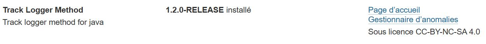
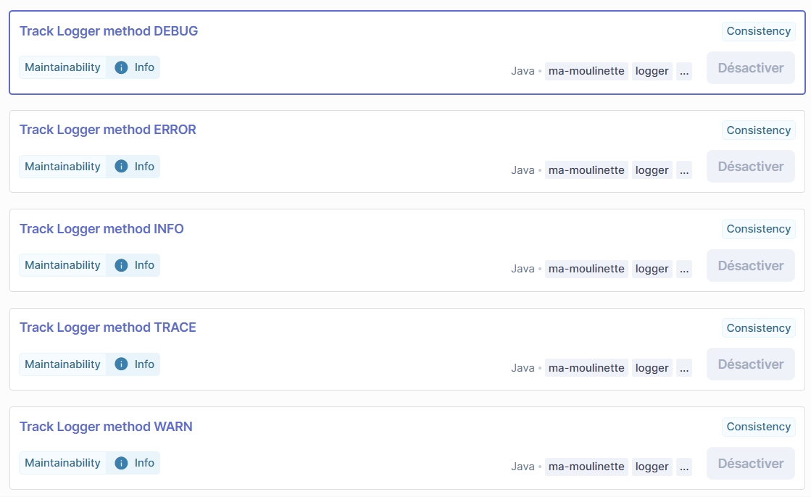
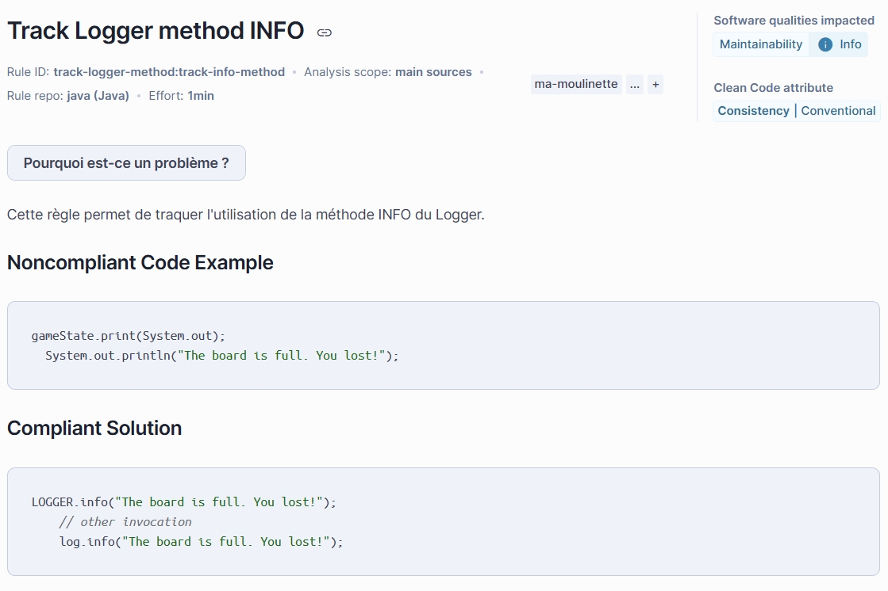
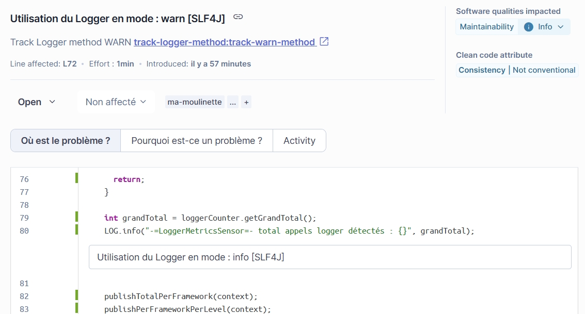
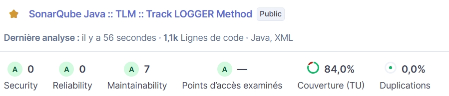

# 👤 Guide utilisateur SonarQube

Ce guide s'adresse aux équipes qui **installent et exploitent** le plugin `track-logger-method` dans une instance SonarQube.
Pour l'architecture interne, le build ou l'ajout d'une règle, voir le [guide développeur](DEVELOPER_GUIDE.md).

## Sommaire

- [Ce que fait le plugin](#-ce-que-fait-le-plugin)
- [Déploiement](#-déploiement)
- [Règles et profil qualité](#-règles-et-profil-qualité)
- [Métriques exposées](#-métriques-exposées)
- [Récupérer les métriques via l'API](#-récupérer-les-métriques-via-lapi)

## 🔍 Ce que fait le plugin

Pour chaque appel `logger.error()`, `.warn()`, `.info()`, `.debug()` ou `.trace()` détecté dans le code Java analysé, le plugin :

1. identifie le **framework de logging** réellement utilisé ;
2. incrémente des **compteurs** par framework et par niveau ;
3. publie ces compteurs (et des ratios en %) comme **métriques custom** dans le domaine `Logger`  du dashboard SonarQube.

### Frameworks détectés

| Framework | Type résolu | Annotation Lombok |
| --- | --- | --- |
| SLF4J | `org.slf4j.Logger` | — |
| Lombok @Slf4j | `org.slf4j.Logger` | `@Slf4j` ✅ |
| Log4j2 | `org.apache.logging.log4j.Logger` | — |
| Lombok @Log4j2 | `org.apache.logging.log4j.Logger` | `@Log4j2` ✅ |
| Log4j1 | `org.apache.log4j.Logger` | — |
| JUL | `java.util.logging.Logger` | — |
| Logback | `ch.qos.logback.classic.Logger` | — |
| Commons Logging | `org.apache.commons.logging.Log` | — |
| JBoss Logging | `org.jboss.logging.Logger` | — |
| Unknown | non résolu (classpath incomplet) | — |

> [!TIP]
> `Unknown` apparaît quand le plugin détecte un appel logger via le nom de variable conventionnel (`LOGGER`, `LOG`, `logger`, `log`) sans pouvoir résoudre le type sémantique exact — généralement un classpath d'analyse incomplet.

## 📦 Déploiement

1. Récupérer `track-logger-method-2.0.0-RELEASE.jar` (voir le [guide développeur](DEVELOPER_GUIDE.md#-compilation) pour le compiler vous-même).
2. Copier le jar dans `extensions/plugins/` de votre serveur SonarQube.
3. Redémarrer le serveur.
4. Vérifier dans les logs que le plugin démarre correctement :

   ```plaintext
   INFO app[][o.s.a.SchedulerImpl] Process[ce] is up
   INFO app[][o.s.a.SchedulerImpl] SonarQube is operational
   ```

5. Le plugin apparaît dans **Administration → Marketplace → Installed** :

   

> [!IMPORTANT]
> Un seul jar `track-logger-method` doit être présent dans `extensions/plugins/`.
> Un ancien jar laissé à côté du nouveau peut faire tourner le plugin deux fois pour la même analyse et provoquer des métriques manquantes ou incohérentes — voir le [guide développeur](DEVELOPER_GUIDE.md#-dépannage) si vous voyez ce symptôme.

### Erreurs fréquentes au déploiement

> [!WARNING]
>
> **`Plugin Java Custom Rules [javacustom] is ignored`**
>
> ```plaintext
> Plugin Java Custom Rules [javacustom] is ignored because the version 8.x.x of required plugin [java] is not installed
> ```
>
> La version du plugin `sonar-java` installée sur votre serveur est plus ancienne que le plancher requis par ce jar.
> Vérifiez la version du plugin Java dans **Administration →  Marketplace**, ou demandez au mainteneur du plugin de vérifier `sonarjava.minVersion` (voir [guide développeur](DEVELOPER_GUIDE.md#-stratégie-de-compatibilité-multi-versions)).

_
> [!WARNING]
>
> **`Plugin key is missing from manifest`**
>
> ```plaintext
> org.springframework.beans.factory.BeanCreationException: ...
> java.lang.NullPointerException: Plugin key is missing from manifest
> ```
>
> Le jar déployé n'a pas été construit avec `sonar-packaging-maven-plugin` (par exemple un jar récupéré depuis `target/classes` au lieu de `target/*-RELEASE.jar`).
>
> Redéployez le jar shadé produit par `mvn clean install`.

## ✅ Règles et profil qualité

Un profil qualité **Ma-Moulinette** est disponible pour Java avec les 5 règles pré-activées :

| Clé de règle | Type | Sévérité | Détecte |
| --- | --- | --- | --- |
| `track-error-method` | CODE_SMELL | Info | `logger.error()` |
| `track-warn-method` | CODE_SMELL | Info | `logger.warn()` |
| `track-info-method` | CODE_SMELL | Info | `logger.info()` |
| `track-debug-method` | CODE_SMELL | Info | `logger.debug()` |
| `track-trace-method` | CODE_SMELL | Info | `logger.trace()` |

> [!WARNING]
> Ces règles sont classées `CODE_SMELL` (pas `BUG`) : elles ne signalent pas un défaut fonctionnel, seulement un usage à tracer à des fins de reporting.
> Les laisser en `BUG` aurait pollué la note *Reliability* du projet au lieu de la note *Maintainability*.





Chaque appel détecté remonte une issue sur la ligne concernée :



Pour lancer une analyse sur un projet Maven :

```bash
mvn sonar:sonar
```



## 📊 Métriques exposées

Toutes les métriques sont publiées dans le domaine **`Logger`**, au niveau projet :

| Clé métrique | Type | Description |
| --- | --- | --- |
| `logger_total_count` | INTEGER | Total tous frameworks et niveaux confondus |
| `logger_<framework>_count` | INTEGER | Total pour un framework donné |
| `logger_<framework>_<level>_count` | INTEGER | Compteur par framework × niveau |
| `logger_<framework>_ratio` | FLOAT | % du total pour ce framework |

`<framework>` ∈ `slf4j`, `lombok_slf4j`, `log4j2`, `lombok_log4j2`, `log4j1`, `jul`, `logback`, `commons_logging`, `jboss`, `unknown`. `<level>` ∈ `error`, `warn`, `info`, `debug`, `trace`.

Exemple de valeurs dans le dashboard :

```plaintext
logger_total_count          = 47
logger_slf4j_count          = 30   →  logger_slf4j_ratio          = 63.8%
logger_lombok_slf4j_count   = 12   →  logger_lombok_slf4j_ratio   = 25.5%
logger_log4j2_count         =  5   →  logger_log4j2_ratio         = 10.6%
logger_slf4j_error_count    =  8
logger_slf4j_warn_count     =  6
logger_slf4j_debug_count    = 16
```

## 🔌 Récupérer les métriques via l'API

### Via l'API Issues (méthode historique)

```plaintext
GET api/issues/search?componentKeys=<clé-projet>&rules=track-logger-method:track-error-method&facets=rules&statuses=OPEN
```

| Paramètre | Rôle |
| --- | --- |
| `componentKeys` | Clé unique du projet |
| `rules` | Règle recherchée, ex. `track-logger-method:track-error-method` |
| `facets` | Filtre de consolidation (`rules`) |
| `statuses` | Statut de l'issue (`OPEN`) |

### Via l'API Measures (recommandé depuis la 2.0.0)

```plaintext
GET api/measures/component?component=<clé-projet>&metricKeys=logger_total_count,logger_slf4j_count,logger_slf4j_ratio,logger_log4j2_count
```

Exemple de réponse :

```json
{
  "component": {
    "measures": [
      { "metric": "logger_total_count",  "value": "47" },
      { "metric": "logger_slf4j_count",  "value": "30" },
      { "metric": "logger_slf4j_ratio",  "value": "63.8" },
      { "metric": "logger_log4j2_count", "value": "5"  }
    ]
  }
}
```

Pour lister toutes les métriques disponibles du domaine `Logger` :

```plaintext
GET api/metrics/search?f=name,description&ps=100
```
